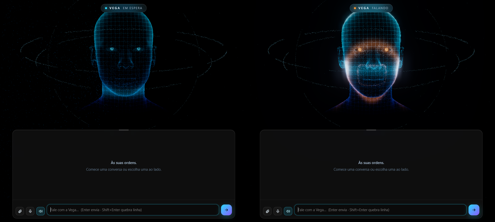

# Vega

Uma página com rosto holográfico 3D para conversar com o **Claude Code**: chat em vidro, respostas ao vivo, voz, microfone e anexos.

> **Resumo de um minuto**
> - É o **seu** Claude Code numa janela bonita: as mesmas conversas, ferramentas e o seu plano. Não usa API paga nem chave.
> - Precisa de **Windows**, **Python 3.10+**, **Microsoft Edge** e o **Claude Code instalado e logado**.
> - Instalar: baixe a pasta, dê dois cliques em `instalar.bat` e abra pelo atalho **Vega** da área de trabalho.
> - Personalizar (nome, voz, cores, personalidade): edite o `config.json` ou peça ao seu Claude com o [guia pronto](PEDIDO-PARA-O-CLAUDE.md).
> - Grátis e aberto, licença MIT.

---

## O que ela faz

- **Rosto 3D** que muda de cor e de expressão: ciano esperando, violeta pensando, âmbar falando, com ondas saindo da boca.
- **Chat em vidro** com a resposta aparecendo enquanto o Claude escreve, e as ferramentas que ele usa em etiquetas curtas.
- **Voz:** a Vega lê em voz alta as linhas que começam com 🔊 e mexe a boca junto. As vozes naturais do Edge funcionam aqui, como Thalita e Francisca.
- **Microfone** para ditar em português, e **anexos** que você arrasta para a janela.
- **Lista de conversas** com busca. São as mesmas conversas do terminal ou do VS Code, então dá para começar num lugar e seguir no outro.
- **Várias conversas ao mesmo tempo:** dá para trocar de conversa enquanto uma resposta ainda está sendo escrita. Ela continua por trás e aparece de novo quando você volta.
- **Modelo por conversa:** ao clicar em *Nova conversa*, você escolhe Sonnet, Opus, Haiku ou o padrão. A escolha vale para a conversa inteira.
- **Barra de progresso:** em tarefas longas, aparece no topo com as etapas, o tempo e um cartão para cada agente trabalhando.
- **Esteira:** diga "coloca na fila" e a tarefa espera numa fila. Ela roda quando você clica em ▶ ou num horário marcado (🌙). Se o limite do plano acabar no meio, a esteira espera zerar e continua de onde parou.
- **Em segundo plano:** processos longos que o Claude deixa rodando aparecem numa coluna à direita, com as etapas, até terminarem.
- **Consumo:** mostra o uso do plano (janela de 5 h e semana, com a hora em que zera) e o tamanho da conversa aberta. Passou de 200 mil tokens, ela avisa que é hora de abrir outra conversa.
- **Modo projetor:** tecla **P** (ou o botão do projetor) deixa só o rosto, em tela cheia e com fundo preto puro, para projetar na parede. **Esc** sai.
- **Monitor em pé:** com a tela na vertical, a lista vira gaveta e os painéis se reorganizam.
- **Navegador (opcional):** com a extensão Claude in Chrome, a Vega mexe no seu Chrome e mostra numa janelinha o que está vendo.

## Antes de instalar

| Precisa | Onde conseguir |
|---|---|
| Windows 10 ou 11 | — |
| Python 3.10 ou mais novo | [python.org](https://www.python.org/downloads/). Na instalação, marque **"Add python.exe to PATH"**. |
| Microsoft Edge | Já vem no Windows. A voz natural e o ditado dependem dele. |
| Claude Code, logado | [Instruções oficiais](https://docs.claude.com/en/docs/claude-code/setup). Depois abra um terminal, digite `claude` e entre na sua conta. |

A Vega usa o plano da sua conta do Claude (Pro ou Max). Cada mensagem gasta o mesmo que gastaria no terminal.

## Instalar

1. Baixe esta pasta (botão **Code → Download ZIP** no GitHub) e extraia num lugar fixo, por exemplo `Documentos\Vega`.
2. Dê dois cliques em **`instalar.bat`**. Ele confere o Python, o Claude Code e o Edge, cria o `config.json` e põe o atalho **Vega** na área de trabalho.
3. Abra pelo atalho. Na primeira vez, o Edge pode pedir para usar o microfone: aceite se quiser falar com ela.

O instalador não baixa nada e não mexe fora da pasta, a não ser para criar o atalho. Pode rodar de novo quando quiser.

## Personalizar

Tudo fica no `config.json`. Depois de mudar, feche e abra a Vega.

| Campo | O que é | Exemplo |
|---|---|---|
| `nome` | Nome da assistente | `"Vega"` |
| `artigo` | "a" ou "o", para as frases saírem certas | `"a"` |
| `usuario` | Seu nome, para ela saber com quem fala (pode ficar vazio) | `"Ana"` |
| `saudacao` | Frase da tela inicial | `"Às suas ordens."` |
| `personalidade` | Jeito de falar, em uma ou duas frases | `"Animada e didática."` |
| `idioma` | Idioma da voz e do ditado | `"pt-BR"` |
| `voz` | Um pedaço do nome da voz do Edge | `"Thalita"`, `"Francisca"`, `"Antonio"` |
| `cores` | Cor de cada estado (espera, pensando, falando) | `"#2ad8ff"` |
| `pasta_trabalho` | Onde o Claude trabalha e de onde vêm as conversas (vazio = Documentos) | `"C:\\Projetos"` |
| `modo_permissao` | Modo de permissão do Claude Code | `"auto"` |
| `chrome` | Liga o controle do Chrome pela extensão Claude in Chrome | `true` |
| `mostrar_limites` | Mostra no topo o uso do plano (5 h e semana) | `true` |
| `porta` | Porta local da página | `8777` |

**Sobre `modo_permissao`:** na Vega não aparece pergunta de permissão como no terminal. Com `"auto"`, o Claude decide sozinho o que é seguro fazer. Se esse modo não existir na sua conta, use `"acceptEdits"`: ele edita arquivos, mas para antes de rodar comandos.

**Trocar o rosto:** substitua `web/modelos/rosto.glb` por outro modelo `.glb`. Se o modelo tiver as expressões ARKit (`jawOpen`, `eyeBlinkLeft`...), ele mexe tudo. Se tiver só `jawOpen`, mexe a boca. Um objeto vazio chamado `boca` marca de onde saem as ondas da fala. Use só modelos que você tem o direito de usar.

## Segurança

- A página abre só neste computador (`127.0.0.1`). Ninguém da rede ou da internet acessa.
- O servidor só aceita pedidos da própria página.
- Nada é enviado para fora além do que o próprio Claude Code já envia para a Anthropic. A única consulta extra é a do uso do plano: a Vega lê o login que o Claude Code já guarda e pergunta à Anthropic quanto do limite foi usado, como faz o `/usage`. Ela não altera nem renova esse login. Para desligar, use `"mostrar_limites": false`.
- A esteira roda tarefas sem ninguém olhando, no mesmo `modo_permissao` do resto. Ela vem orientada a não publicar, não gastar e não apagar nada, mas só coloque na fila o que você rodaria sem supervisão.
- O `config.json` e a pasta `dados/` (anexos, perfil do Edge, registros) ficam fora do Git.

## Problemas comuns

- **"Não achei o Python":** reinstale o Python marcando "Add python.exe to PATH".
- **Claude Code não encontrado:** instale e rode `claude` uma vez no terminal para entrar na conta.
- **Sem voz:** abra pelo atalho, que usa o Edge. Confira o botão de alto-falante no topo e o nome em `voz`.
- **Página não abre:** veja `dados/servidor.log`. Se outra coisa usa a porta 8777, troque `porta` no `config.json`.
- **"Limite atingido":** é o limite do seu plano do Claude. Espere renovar.

## Créditos e licença

Código sob [licença MIT](LICENSE). Rosto e bibliotecas de terceiros: veja [CREDITS.md](CREDITS.md).

A Vega é um projeto independente. Não é feita nem endossada pela Anthropic.
